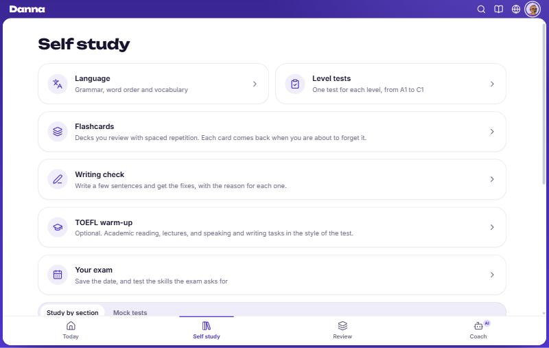
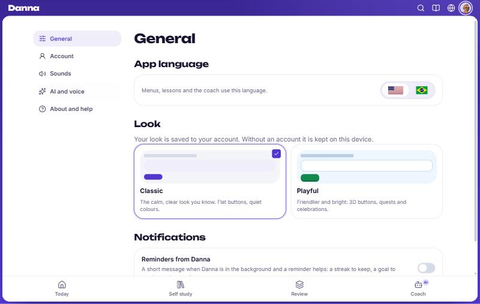

<p align="center">
  
</p>

Danna is an English course for Windows. It takes you from A1 to C1 in small lessons, with spaced cards for the words you keep forgetting, a writing check that explains every fix, and a coach you can talk to.

**[Download for Windows](https://github.com/emireln/danna/releases/latest)** · [danna.run](https://danna.run)

<p align="center">
  
  
  
</p>

## What's inside

- **Roadmap.** General English from A1 to C1, in units with lessons, unit checks and a level test.
- **Self study.** Reading, listening, speaking, writing and grammar, one skill at a time, plus an optional TOEFL warm-up.
- **Decks and review.** Flashcards with spaced repetition. The questions you missed come back when you need them.
- **Writing check.** Write up to 1,500 words, and get a score and each fix with its reason.
- **Coach.** A tutor for chat, conversation and exam practice. Bring your own key from OpenAI, Anthropic, Google Gemini, OpenRouter or DeepSeek.
- **Library.** Read your PDF, TXT and Markdown files, and tap a word to see what it means.

You can pick the Classic or the Playful look in Settings.

## Accounts and privacy

Use Danna on this device, or sign in to an online account to keep your progress in sync and add friends. Your AI keys are encrypted by Windows, and they only go to the provider you connected.

## Good to know

- TOEFL scores are estimates for practice, not official results.
- The coach and the full writing check need an AI key. Without one, the basics are still checked on your device.
- Google sign-in isn't available yet.

## Run it from source

```bash
npm install
npm run dev   # the desktop app, with hot reload
npm run web   # the same interface in a browser
npm test
```

Botdanna, the AI coach app, lives in [its own repository](https://github.com/emireln/botdanna). The online account setup, the release steps and the details are in [docs/setup.md](docs/setup.md).
