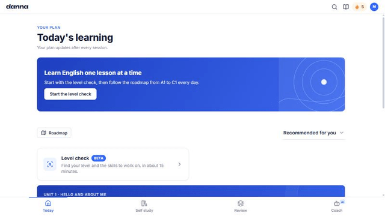
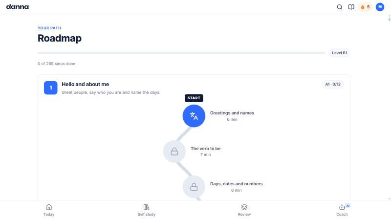
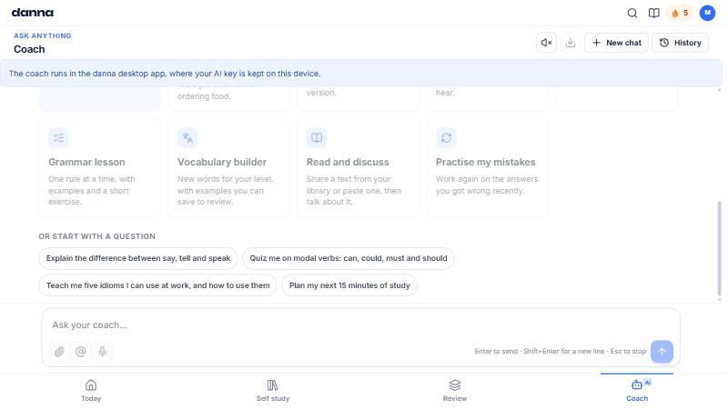
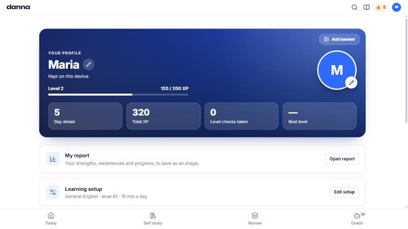

# danna

**Learn English one lesson at a time.** danna is an English learning app for Windows. It takes you from A1 to C1, with an optional TOEFL warm-up, and it lives in its own window with a tray icon, so practice is always one click away.

<p align="center">
  
</p>

## Take a look

<table>
  <tr>
    <td width="50%" align="center">
      
      <br><sub>Today: your plan for the day</sub>
    </td>
    <td width="50%" align="center">
      
      <br><sub>The roadmap: each lesson unlocks the next</sub>
    </td>
  </tr>
  <tr>
    <td width="50%" align="center">
      
      <br><sub>Self study: practise a skill on its own</sub>
    </td>
    <td width="50%" align="center">
      
      <br><sub>The coach: ask anything, or pick a way to practise</sub>
    </td>
  </tr>
  <tr>
    <td colspan="2" align="center">
      
      <br><sub>Your profile: your streak, your XP and your report</sub>
    </td>
  </tr>
</table>

## Two ways to use it

- **On this device.** No account needed. Your progress stays on your computer. Friends and sharing aren't part of this mode.
- **With an online account.** Your progress follows you to your other devices, and you can add friends. You can switch between the two in Settings at any time. When you switch, you choose whether to bring your progress along.

Your picture works in both modes. Pictures are shrunk automatically, so they load quickly.

## What you'll find

- **Today.** Your plan for the day, the level check, and a card for your exam.
- **Your exam.** Save the exam's name, date and target score. You'll see how many days are left and how you're doing in each skill. You can pause it until you're ready to plan again.
- **Roadmap.** General English from A1 to C1. Each unit has lessons, a unit check, stars and unlocking. Your level decides where you start. If you leave a lesson halfway, it's saved, so you can pick up the same question later.
- **Self study.** Practice for reading, listening, speaking, writing and language. There's a level test for each level, plus an optional TOEFL warm-up.
- **Level check and report.** See your level on a five-skill chart, with tips and a study plan. With the TOEFL warm-up, you also get an estimated score out of 120.
- **Review.** The questions you missed come back at the right time, so they stick.
- **Coach.** A tutor that knows your level, your goal, your exam date and the answers you got wrong. Pick how you'd like to practise: free chat, conversation, help with writing, speaking, exam practice, grammar, vocabulary, reading, or your own mistakes. Replies appear as they're written. You can have them read aloud, speak with the microphone (this needs an OpenAI key), and save a chat as a Markdown file.
- **My library.** Keep your PDF, TXT and Markdown files and read them in the app. You can edit the text files too. Save useful links from YouTube, Coursera, Khan Academy and more, and sort them into categories. The tutor can answer questions about the files you choose, and it only uses those files.
- **Friends** (online only). Find people by their username, send requests, see a ranking, share results and sets, and open a friend's profile.
- **Profile.** A banner (optional), your picture, your day streak and your report, which you can save as an image. Your streak turns red above 200 days, blue above 500, and purple from 1000.
- **Support and feedback.** Buy me a coffee from the profile menu or from Settings. In Settings you can also rate danna from 1 to 5 stars and leave a comment. This works with an online account, and you can send one message an hour.
- **What's new and updates.** Release notes and banners. New versions are offered in the app, and you decide when to download and restart.
- **Search.** Press the search button in the title bar, or Ctrl+K, to find lessons, tests, chats, files, links and pages.
- **AI, with your own key.** Use OpenAI, Anthropic, Google Gemini, OpenRouter or DeepSeek. The newest model is picked for you, and you can change it in Settings. Listening passages can be read aloud in a natural voice with an OpenAI or Gemini key. The text is sent to the provider you connected.

## Getting started

```bash
npm install
npm run dev
```

The settings for the online account are already in `.env.development` and `.env.production`. They only hold public values: the project address and the publishable key. To use your own Supabase project, copy `.env.example` to `.env.local` and fill it in.

Want to tweak the design quickly? Run `npm run web` and open the app in your browser. The desktop features (tray, window bar, AI keys, the offline database, sign-in and library files) only work in the desktop app.

## Running the tests

```bash
npm test
```

The tests check the things that would hurt most if they broke: the lessons, copying progress between devices and accounts, how AI keys are sealed, the library, links, the coach, and the database rules. The database tests run a real PostgreSQL schema in memory, so there's nothing extra to install.

## Logos and icons

`brand/logo.png` is the master logo. After you change it, or add a platform logo, run:

```bash
npm run art
```

That makes everything the app and the installer need:

- The app logo and icon, for the app, the window, the tray and the installer (`npm run icons`).
- Logos for learning platforms like YouTube and Coursera (`npm run logos`). A platform without an official logo shows its first letter until one is added to `brand/platforms/`.
- The side picture of the installer (`npm run installer-art`).

## Build the Windows installer

```bash
npm run dist
```

The installer lands in `release/danna-setup-<version>-x64.exe`. If there's an older `release` folder, delete it first.

## Set up the online account (Supabase)

You only need this if you want accounts.

1. **New project.** In the Supabase dashboard, open **SQL Editor**, paste all of `supabase/schema.sql`, and run it. It's safe to run again.
2. **Existing project.** Run the migration files below in the **SQL Editor**, one at a time, in order. Each one is safe to run again.

| File | What it adds |
| --- | --- |
| `supabase/migrations/0002_library.sql` | My library and its private files |
| `supabase/migrations/0003_general_english.sql` | The learning goal and the A1 level |
| `supabase/migrations/0004_release_0_5_0.sql` | The 0.5.0 release notes |
| `supabase/migrations/0005_release_0_6_0.sql` | Coach chats, and the 0.6.0 release notes |
| `supabase/migrations/0006_release_0_7_0.sql` | Profile banners, friends' profiles, and the 0.7.0 release notes |
| `supabase/migrations/0007_account_ai_keys.sql` | AI keys saved to your account, sealed with your password |
| `supabase/migrations/0008_release_0_8_0.sql` | The 0.8.0 release notes |
| `supabase/migrations/0009_feedback.sql` | Feedback from the account |
| `supabase/migrations/0010_release_0_9_0.sql` | The 0.9.0 release notes |
| `supabase/migrations/0011_release_1_0_0.sql` | The name of the exam, and the 1.0.0 release notes |
| `supabase/migrations/0012_release_1_1_0.sql` | The 1.1.0 release notes |
| `supabase/migrations/0013_coach_modes.sql` | The coach's modes, and longer coach messages |
| `supabase/migrations/0014_release_1_2_0.sql` | The 1.2.0 release notes |
| `supabase/migrations/0015_exam_paused.sql` | Pausing the exam |
| `supabase/migrations/0016_release_1_3_0.sql` | The 1.3.0 release notes |
| `supabase/migrations/0017_feedback_limit.sql` | One feedback message an hour |
| `supabase/migrations/0018_release_1_4_0.sql` | The 1.4.0 release notes |
| `supabase/migrations/0019_release_1_4_3.sql` | The 1.4.1, 1.4.2 and 1.4.3 release notes |

The coach needs `0013` before it shows the chat list.

3. In **Authentication**, keep email confirmation on, and set the Site URL and the redirect URLs for the app.
4. Never put a service-role or secret key into the app. Only the publishable key goes in.

## Release notes and banners

In the Supabase Table Editor, add rows to `announcements`:

- **A release note.** Set `kind` to `release_note`, add a `version`, a `title` and a `body`. Put one feature per line, each starting with `- `, and set `published` to true.
- **A banner.** Set `kind` to `banner`, add a `title` and a short `body`, pick an `accent` (`blue`, `teal`, `amber` or `ink`), and optionally add a picture (`image_url`) and a button (`cta_label` and `cta_url`). The button can open a page in the app, like `/play/diagnostic`, or any `https://` link.

People on this device see the release notes and banners bundled in `src/content/announcements.ts`.

## Where your data lives

- **On this device.** Your progress, your picture, and your library files and links are kept in a small database (`danna.db`) in the app's data folder. Nothing is sent anywhere.
- **Sign-in.** The session is saved in `danna-session.bin`, encrypted by Windows, so only this app and this Windows user can read it.
- **Online.** Your account lives in Supabase, and each person can only see their own rows. Friends see the results and sets you share with them, for as long as you stay friends. Your picture, your banner and your library files are private: friends can see your picture and banner, but never your files. Feedback you send is kept in the database, where only the project owner can read it.
- **AI keys.** On your device, Windows encrypts each key, and only the app's main process can use it. With an online account, each key is also saved to your account, sealed with your password. The database only ever sees scrambled text, so you add a key once. When the tutor reads your files, it sends only the parts you picked, to the provider you connected.

## How it's kept safe

- The desktop window runs sandboxed, with no direct access to Node, and it only opens `https` links.
- The app can only talk to its own project address, and a content security policy limits what images, scripts and frames can load.
- The packaged app turns off the Electron features that would let code run from outside, or be debugged from the command line.
- Friend requests can't be forged or accepted for someone else. Your XP never goes down online.
- Everyone has limits on how much they can store, so one account can't fill the database. For example, the library allows 300 files of up to 20 MB each, and 2,000 links.
- XP and streaks are worked out on your device. The database stops them from going down, but it can't check how you earned them.
- Keys saved to an account are sealed before they leave your device. A password reset from the email link can't open them, so you'll add those keys again once.

## Project structure

```
brand/         The master logo, and the platform logos (brand/platforms)
docs/          Screenshots and the tour GIF for this page
electron/      The desktop shell: window, tray, offline database, sign-in, AI keys and providers
scripts/       Logo, icon and installer art, plus the version bump and the release
src/           The interface (React and TypeScript)
  assets/      Logo, icon and platform logos
  components/  Title bar, shared pieces, file viewer, tutor, charts, question renderer
  content/     Lessons for A1 to C1 and the TOEFL warm-up (units/), passages, tests and release notes
  lib/         Scoring, grading, review, AI prompts, data backends, progress copying, library and platforms
  screens/     One file per screen
  state/       Auth, AI, app data and toasts
supabase/      The database schema, the migrations for existing projects, and the database tests
tests/         Tests for lessons, copying, the library, platforms and AI providers
```

## Limits in this version

- TOEFL scores are estimates for practice, not official scores.
- Speaking answers are transcribed with an OpenAI key. Without one, you rate your own answer.
- The tutor needs an AI key. A scanned PDF has no text until it's converted with OCR.
- Platform logos come from the open Simple Icons set. Some platforms (Alura, BBC Learning English, Cambridge and ETS) don't have an open logo yet, so they show their first letter.
- Google sign-in isn't included yet.

## Versions and releases

Each commit adds 1 to the patch number, automatically, with a pre-commit hook in `.husky/`. When you start a new feature release, run `npm run bump -- minor` and commit it. A version you set by hand in a commit stays as it is.

To publish the current version: push the commit, run `npm run dist` to build the installer, and then run `npm run release`. The release is named after the version (tag `v<version>`), and the commit messages since the last release become its notes.
